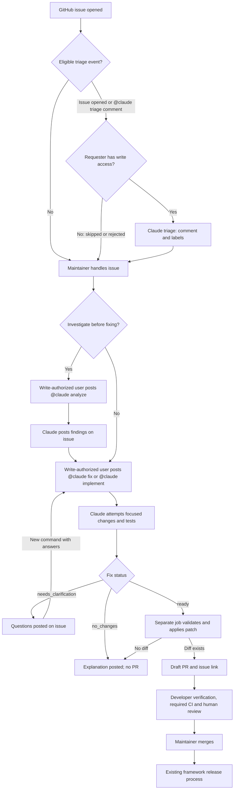

# Framework maintenance with AI agents — current approach

## What this process covers

Framework repositories can use three reusable GitHub Actions workflows to assist with maintenance: [`ai-triage.yml`](.github/workflows/ai-triage.yml) classifies issues, [`ai-analyze.yml`](.github/workflows/ai-analyze.yml) investigates them, and [`ai-fix.yml`](.github/workflows/ai-fix.yml) attempts fixes. Each runs Claude Code in the **calling framework repository**. Analyze and Fix can be enabled independently.

The GitHub issue is the working record. **People choose priorities, authorize requested work, review changes, merge, and release.** The workflows do not schedule work or publish releases.

## End-to-end process



### 1. Capture and triage the issue

A reporter opens an issue in the owning framework repository. Triage runs when a user with write access opens an issue, or when a user with write access comments `@claude triage` (optionally with context). **The workflow checks the requester's write access before checkout.** A reporter without write access does not trigger triage; a maintainer comments `@claude triage` to request it. The same command retriages any issue using the maintainer's input. See [Authorization](#authorization-and-command-rules) for the distinction between starting a workflow and running the AI action.

Triage consults the issue, comments, repository guidance, templates, and existing labels. It can:

- Add an existing classification label (normally `bug`, `enhancement`, or `question`) without replacing existing labels.
- Ask up to three focused questions and add `need information` if clarification is necessary.
- Link plausible duplicates without closing the issue or claiming a confirmed match.
- Post one concise triage comment and add `ai-triaged` if that label exists. Initial triage posts at most once per issue; each `@claude triage` posts an updated comment and may change the classification.

Triage does **not** edit code, execute project code, close issues, or decide priority. A missing label is skipped rather than created.

### 2. Decide and investigate, if needed

The maintainer reviews the issue, fills information gaps with the reporter, and chooses whether and when to proceed. Analysis is optional; a clear request can go straight to a fix. To investigate, a write-authorized user posts a **new issue comment** beginning with:

```text
@claude analyze Investigate the failure, identify the affected code path, and explain compatibility risks.
```

The Analyze agent reads the discussion and default-branch files. It writes one comment of under 400 words, which a later workflow step posts: a summary, linked evidence, assumptions, a file-level change plan, test cases, risks, and any open questions. **It does not edit files or run project code.** The maintainer decides whether the findings justify a fix.

### 3. Request a fix or feature and receive an outcome

When the desired behavior is clear, a write-authorized user posts a **new issue comment** beginning with:

```text
@claude fix Correct the reported failure, preserve the public API, and add a regression test.
```

For a feature, use `@claude implement` with the desired behavior. Both commands
run the same workflow.

The Fix agent checks out the default branch and reads the discussion, including any earlier analysis. It attempts a focused change, adds regression tests where appropriate, and reports which checks actually ran. It leaves edits uncommitted and returns one of three statuses:

| Status | What happens next |
| --- | --- |
| `ready` | The publisher checks the base SHA and patch, then creates or updates a draft PR on `fix/issue-<number>` for a `bug` label, `feat/issue-<number>` for an `enhancement` label, or `chore/issue-<number>` otherwise, **if there is a diff**. `bug` takes precedence if both labels exist. It posts the PR link on the issue. |
| `needs_clarification` | Questions are posted on the issue. Any partial edits are linked as a one-day patch artifact, not pushed to a branch or PR. Reply with a **new `@claude fix` or `@claude implement` comment** containing the answers. |
| `no_changes` | An explanation is posted on the issue; no PR is created. |

`Fix` runs the trusted default-branch baseline before Claude starts. The warm-up shell unsets the OIDC request variables, but the job still has OIDC permission for Claude authentication. Only warmup receives optional read-only JFrog credentials. Dependencies stay on the same runner without cross-run Maven caching. Claude runs the offline verifier in a sandbox configured to hide federation files and credentials. The agent is instructed to mark a fix `ready` only if verification passed on the final change, and to ask for clarification if the fix needs a dependency unavailable offline.

A one-day artifact transfers the patch, base SHA, and PR metadata to `PublishFix`, which has write permissions but no OIDC and applies the patch **without running project code**. If the default branch moved, publication stops; request a fresh fix. Available offline verification logs are kept separately for one day.

### 4. Verify, review, merge, and release

The developer reviews the diff, tests, executed checks, and limitations on the draft PR. Complete missing verification on the **actual PR changes**. Required CI, branch protections, and human approval still govern merge; the agents cannot approve or merge. The framework's release owner handles documentation, release notes, versioning, and publication through its existing process.

When available in the calling repository, a maintainer can assign a **GitHub Copilot agent as a PR code reviewer**. Review its findings, address actionable feedback, and request another review after substantive changes if useful. Copilot review supplements, rather than replaces, developer verification, required CI, and human approval; the maintainer remains responsible for the merge decision.

**CI requires an explicit check.** The publisher uses `GITHUB_TOKEN`; pushes do not start `push` workflows, and eligible `pull_request` runs need approval. Before merge, approve the runs or use the repository's manual CI path to verify the actual PR head. See [CI triggering](README.md#fix-publication). PR comments do not trigger Analyze or Fix; for another AI fix, add a new `@claude fix` request on the issue, coordinating first with anyone editing the existing PR branch.

## Repository setup

These are **reusable workflows** (`workflow_call`), not issue listeners until a framework repository calls them. For each GitHub-hosted framework:

1. Add the triage caller for `issues: [opened]` and `issue_comment: [created]`. Add separate callers for Analyze and Fix as needed, both using `issue_comment: [created]`. Fix defaults to Temurin Java 8; set the version your project needs. For private Maven dependencies, use the read-only JFrog mapping in the [README](README.md#setup).
2. Configure Anthropic workload identity federation and set the organization and per-workflow rule IDs as Actions variables in the caller's context. Grant each caller job `id-token: write` in addition to its GitHub repository permissions; the reusable workflows narrow permissions per job.
3. Provide repository-specific `AGENTS.md` guidance, relevant issue templates, test instructions, and the labels needed for triage. Add `CLAUDE.md` importing `@AGENTS.md` where used.
4. Enable GitHub Actions PR creation, preserve human-review protections, and verify how CI will run on bot-created PRs.

Use the [README setup examples](README.md#ai-framework-maintenance) and a reviewed shared-workflow revision. A workflow in this repository does not run on another repository's issues until that repository installs a caller.

## Authorization and command rules

**A workflow run is not an authorized AI run.** The YAML checks `user.type == 'User'` to exclude bots, not to verify permission. A read-only human can start a caller run. All three workflows check write access in a `Gate` job before adding an eyes reaction or starting the agent job. The Claude Code Action also checks requester write access.

- For a newly opened issue, the requester is the issue author. For an issue comment (including `@claude triage`), it is the commenter.
- Use `@claude triage`, `@claude analyze`, `@claude fix`, or `@claude implement` at the very start of a **new, human-authored issue comment**. Matching is case-insensitive. Use the command alone or put a literal space before task details. Leading whitespace, bare mentions, `@claude review`, PR comments, and edited comments do not start an agent job.
- A rejected request may still show an Actions run but should not produce AI output. A clarification reply without a new command does not restart a run.

## Run limits

| Operation | Agent turn limit | Claude CLI budget per run | Job timeout |
| --- | ---: | ---: | ---: |
| Triage | 12 | $1 | 10 minutes |
| Analyze | 20 | $3 | 20 minutes |
| Fix | 30 | $6 | 60 minutes |

Analyze and Fix each have a separate 5-minute acknowledgment job; Fix publication has a 10-minute timeout. Baseline preparation is included in the Fix timeout. Budgets apply **per invocation**, not across the repository or organization. Anthropic API and GitHub runner usage are charged separately.
