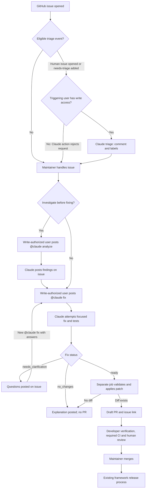

# Framework maintenance with AI agents — current approach

## What this process covers

Framework repositories can use two reusable GitHub Actions workflows to assist with maintenance: [`ai-triage.yml`](.github/workflows/ai-triage.yml) classifies issues, and [`ai-assistant.yml`](.github/workflows/ai-assistant.yml) investigates or attempts fixes when a maintainer asks. Both run Claude Code in the **calling framework repository**. This describes the available process, not a claim that every framework has enabled it.

The GitHub issue is the working record. **People choose priorities, authorize requested work, review changes, merge, and release.** The workflows do not schedule work or publish releases.

## End-to-end process



### 1. Capture and triage the issue

A reporter opens an issue in the owning framework repository. Triage is selected when a human opens an issue or someone adds `needs-triage`. **The Claude Code Action runs only for a write-authorized triggering user**: an external reporter's new issue cannot run triage directly, but a maintainer with write access can add `needs-triage` to request it. See [Authorization](#authorization-and-command-rules) for the distinction between starting a workflow and running the AI action.

Triage consults the issue, comments, repository guidance, templates, and existing labels. It can:

- Add an existing classification label (normally `bug`, `enhancement`, or `question`) without replacing existing labels.
- Ask up to three focused questions and add `need information` if clarification is necessary.
- Link plausible duplicates without closing the issue or claiming a confirmed match.
- Post one concise triage comment and add `ai-triaged` if that label exists. On reruns, a comment marker helps prevent duplicate comments.

Triage does **not** edit code, execute project code, close issues, or decide priority. A missing label is skipped rather than created.

### 2. Decide and investigate, if needed

The maintainer reviews the issue, fills information gaps with the reporter, and chooses whether and when to proceed. Analysis is optional; a clear request can go straight to a fix. To investigate, a write-authorized user posts a **new issue comment** beginning with:

```text
@claude analyze Investigate the failure, identify the affected code path, and explain compatibility risks.
```

The Analyze agent reads the discussion and default-branch files. It posts one comment with evidence, confirmed findings versus hypotheses, a proposed fix scope and regression test, compatibility risks, and any unanswered questions. **It does not edit files or run project code.** The maintainer decides whether the findings justify a fix.

### 3. Request a fix and receive an outcome

When the desired behavior is clear, a write-authorized user posts a **new issue comment** beginning with:

```text
@claude fix Correct the reported failure, preserve the public API, and add a regression test.
```

The Fix agent checks out the default branch and reads the discussion, including any earlier analysis. It attempts a focused change, adds regression tests where appropriate, and reports which checks actually ran. It leaves edits uncommitted and returns one of three statuses:

| Status | What happens next |
| --- | --- |
| `ready` | The publisher checks the base SHA and patch, then creates or updates a draft PR on `fix/issue-<number>` for a `bug` label, `feat/issue-<number>` for an `enhancement` label, or `chore/issue-<number>` otherwise, **if there is a diff**. `bug` takes precedence if both labels exist. It posts the PR link on the issue. |
| `needs_clarification` | Questions are posted on the issue; partial edits are not published. Reply with a **new `@claude fix` comment** containing the answers. |
| `no_changes` | An explanation is posted on the issue; no PR is created. |

The Fix job has read-only GitHub permissions. A one-day artifact transfers its patch, base SHA, and PR metadata to a fresh `PublishFix` job with write permissions. The publisher validates the handoff and applies the patch **without running project code**. If the default branch moved, publication stops; request a fresh fix. Fix may itself run project code while holding the model credential, so separating publication credentials does not make Fix a sandbox.

### 4. Verify, review, merge, and release

The developer reviews the diff, tests, executed checks, and limitations on the draft PR. Complete missing verification on the **actual PR changes**. Required CI, branch protections, and human approval still govern merge; the agents cannot approve or merge. The framework's release owner handles documentation, release notes, versioning, and publication through its existing process.

When available in the calling repository, a maintainer can assign a **GitHub Copilot agent as a PR code reviewer**. Review its findings, address actionable feedback, and request another review after substantive changes if useful. Copilot review supplements, rather than replaces, developer verification, required CI, and human approval; the maintainer remains responsible for the merge decision.

**CI requires an explicit check.** The publisher uses `GITHUB_TOKEN`; pushes and PR creation with that token do not automatically trigger ordinary `push` or `pull_request` workflows. Before merge, verify the repository has a way to run required checks on this PR head. For `push` workflows, confirm branch filters include its `fix/`, `feat/`, or `chore/` prefix; `pull_request` branch filters match the base branch instead. PR comments do not trigger this assistant; for another AI fix, add a new `@claude fix` request on the issue, coordinating first with anyone editing the existing PR branch.

## Repository setup

These are **reusable workflows** (`workflow_call`), not issue listeners until a framework repository calls them. For each GitHub-hosted framework:

1. Add a caller on the default branch for `issues: [opened, labeled]` and a second caller for `issue_comment: [created]`.
2. Pass `ANTHROPIC_API_KEY` explicitly. Grant triage contents-read/issues-write permissions and the assistant caller contents/issues/PRs-write permissions; the assistant's individual jobs narrow those permissions.
3. Provide repository-specific `AGENTS.md` guidance, relevant issue templates, test instructions, and the labels needed for triage. Add `CLAUDE.md` importing `@AGENTS.md` where used.
4. Enable GitHub Actions PR creation, preserve human-review protections, and verify how CI will run on bot-created PRs.

Use the [README setup examples](README.md#ai-framework-maintenance) and a reviewed shared-workflow revision. A workflow in this repository does not run on another repository's issues until that repository installs a caller.

## Authorization and command rules

**A workflow run is not an authorized AI run.** The YAML checks `user.type == 'User'` to exclude bots, not to verify permission. A read-only human can start a caller run or the assistant's routing job. The `Triage`, `Analyze`, and `Fix` jobs invoke `anthropics/claude-code-action@v1` with `github_token`; the action's built-in requester write-access check rejects read-only users before Claude performs the operation. There is no separate permission lookup in these YAML files.

- For a newly opened issue, the requester is the issue author. For `needs-triage` labeling, it is the person adding the label. For an issue comment, it is the commenter.
- Assistant commands must be lowercase `@claude analyze` or `@claude fix` at the beginning of a **new, human-authored issue comment** (leading whitespace is allowed). The assistant ignores bare mentions, `@claude review`, PR comments, and edited comments.
- A rejected request may still show an Actions run but should not produce AI output. A clarification reply without a new command does not restart a run.

## Run limits

| Operation | Agent turn limit | Claude CLI budget per run | Job timeout |
| --- | ---: | ---: | ---: |
| Triage | 12 | $1 | 10 minutes |
| Analyze | 30 | $6 | 35 minutes |
| Fix | 30 | $6 | 35 minutes |

Routing has a separate 5-minute timeout, and fix publication has a 10-minute timeout. Budgets apply **per invocation**, not across the repository or organization. Anthropic API and GitHub runner usage are charged separately.
